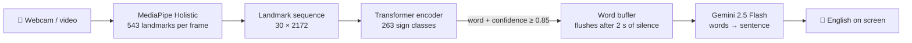

<div align="center">

# 🤟 HyperTranslator

### Real-time Indian Sign Language → English

Sign in front of a webcam, read the sentence on screen.
MediaPipe Holistic tracks 543 body, hand and face landmarks per frame, a Transformer encoder
recognizes the sign, and Gemini turns the stream of signs into natural English.


[](LICENSE)


</div>

---

## Why

Indian Sign Language is used by millions of deaf people in India, and very few hearing people understand it.
Most sign-recognition demos stop at isolated words. HyperTranslator aims for full sentences: ISL grammar
drops articles and the verb "to be", so recognized signs are passed to a language model that rebuilds
fluent English while keeping the signer's meaning.

## How it works



1. **Capture** — 30 consecutive frames (about one second of signing).
2. **Landmarks** — per frame: pose (33) + left hand (21) + right hand (21) + face (468) points × (x, y, z, visibility) = **2,172 features**.
3. **Recognize** — a Transformer encoder reads all 30 frames at once, so every frame attends to every other. That captures the whole arc of a sign better than an LSTM, which forgets early frames.
4. **Buffer** — confident predictions accumulate until the signer pauses for 2 seconds.
5. **Translate** — Gemini rewrites the word list as one grammatical sentence, with a plain join as fallback if the API is unavailable.

## Sign recognizer

```
Input (30, 2172)
  → Linear projection         (30, 256)
  → Prepend CLS token         (31, 256)
  → Positional encoding
  → Transformer encoder × 4   d_model 256 · 8 heads · FFN 512 · dropout 0.1 · pre-LayerNorm
  → CLS output                (256,)
  → LayerNorm → Linear(256→128) → GELU → Dropout → Linear(128→263)
  → Softmax
```

| Training | |
|---|---|
| Dataset | [INCLUDE](https://zenodo.org/record/4010759) (IIT Bombay) — 263 ISL classes, ~4,287 clips |
| Optimizer | AdamW (lr 1e-4, weight decay 0.01), cosine annealing, grad clip 1.0 |
| Loss | Cross-entropy with label smoothing 0.1 |
| Augmentation | Time shift, Gaussian noise, horizontal flip with hand swap |
| Targets | ≥ 92% validation accuracy · ≤ 100 ms inference per sequence on CPU |

## Roadmap

| Phase | | Status |
|---|---|---|
| 1 | Project scaffold — FastAPI service with health check and tests, Next.js app, Docker image | ✅ Done |
| 2 | MediaPipe landmark extraction | 🔄 In progress |
| 3 | INCLUDE dataset preprocessing | ⏳ Planned |
| 4 | Transformer training and evaluation | ⏳ Planned |
| 5 | Recognition API — `/predict/frame-sequence`, `/predict/video` | ⏳ Planned |
| 6 | Gemini sentence builder — `/sentence` | ⏳ Planned |
| 7 | Live webcam UI with landmark overlay, video upload, deployment | ⏳ Planned |
| — | **v2:** graph-convolutional front end (SignFormer-GCN) + RGB stream, aiming for ~96% | 💡 Idea |

The full technical design — API contracts, UI states, training commands and deployment — is in
[`specs/isl_translation.md`](specs/isl_translation.md).

## Getting started

**Backend** (Python 3.11)

```bash
cd backend
python -m venv .venv && source .venv/bin/activate   # Windows: .venv\Scripts\activate
pip install -r requirements.txt
cp .env.example .env                                 # add GEMINI_API_KEY
uvicorn main:app --reload                            # http://localhost:8000/health
pytest
```

**Frontend**

```bash
cd frontend
npm install
npm run dev                                          # http://localhost:3000
```

**Dataset** — see [`data/README.md`](data/README.md) to download INCLUDE and extract landmarks.

## Project structure

```
backend/
├── main.py                  # FastAPI app
├── models/                  # sign recognizer + sentence builder
├── utils/                   # landmark extraction
└── tests/
frontend/src/
├── app/                     # Next.js App Router
└── components/              # WebcamCapture, VideoUpload, TranslationDisplay
training/                    # preprocess · train · evaluate
data/                        # dataset instructions (raw data is not committed)
specs/                       # technical design
```

## License

[MIT](LICENSE) © Barnak Roy Nandy
